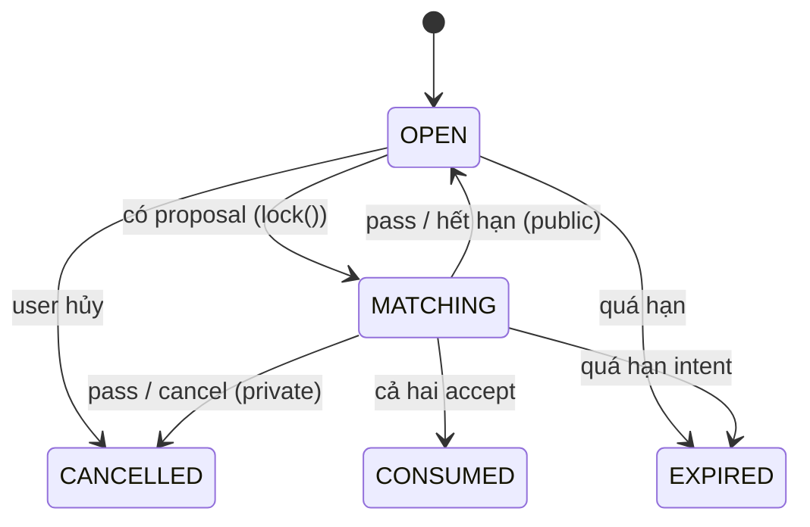
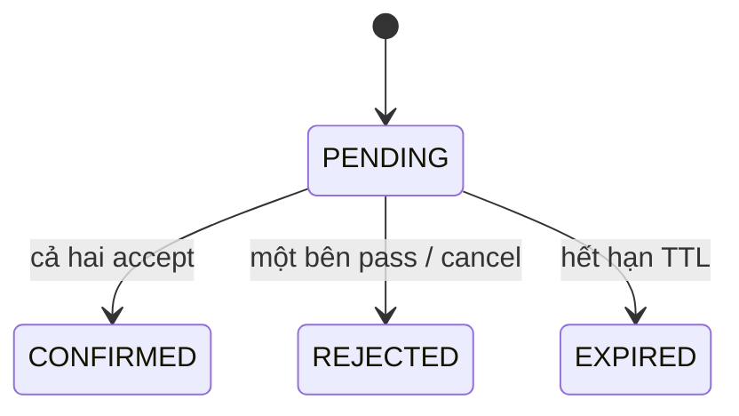
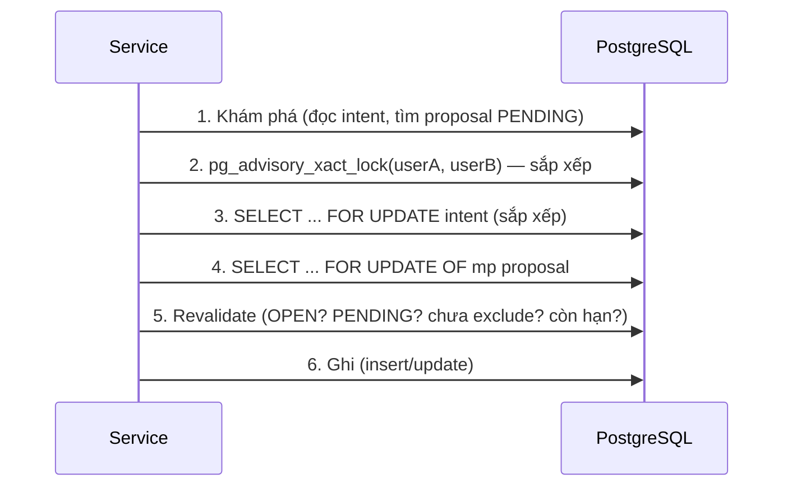

# Matching Flow — Giải thích Kiến trúc & Cơ chế hoạt động

Tài liệu này **giải thích** cách hệ thống ghép đôi (matching) hoạt động sau lần tái cấu
trúc chống *double-booking*. Nó tập trung vào *hiểu* (concept, cơ chế, lý do hệ thống
an toàn), không phải là hướng dẫn từng bước hay danh sách việc cần làm.

Các quyết định và sự đánh đổi đằng sau mỗi cơ chế được ghi riêng trong
[`matching-flow-decisions.md`](./matching-flow-decisions.md) (ADR).

---

## 1. Tổng quan

WalkMate ghép hai người có ý định đi bộ (*walk intent*) trùng khung giờ tại cùng một
địa điểm (*hotspot*). Có hai cách để một cặp được hình thành:

1. **Ghép công khai (public matching)** — người dùng tạo một intent công khai, hệ thống
   tìm một intent công khai khác có khung giờ giao nhau và tạo ra một **proposal**
   (đề xuất ghép đôi). Hai bên lần lượt **accept**; khi cả hai accept, một
   **walk session** được tạo ra.
2. **Lời mời trực tiếp (private invite)** — người dùng mời một người bạn cụ thể; hệ
   thống tạo intent cho cả hai, tạo proposal, và tự động accept phía người mời.

Trong cả hai trường hợp, **một người không được có hai hoạt động chồng lấn khung giờ**
(bất kể là intent, proposal hay session) — đây chính là bất biến chống double-booking.

---

## 2. Mô hình dữ liệu và trạng thái

Ba thực thể chính: `WalkIntent`, `MatchProposal`, `WalkSession`.

### 2.1 `WalkIntent` — ý định đi bộ

Một intent gắn với một user, một hotspot, một khung giờ `[start, end)`, và các ràng
buộc ghép đôi (`MatchingConstraints`). Trạng thái:



- `OPEN` — đang tìm bạn ghép.
- `MATCHING` — đã có proposal, tạm rút khỏi pool tìm kiếm (soft-lock).
- `CONSUMED` — đã ghép thành công (session được tạo).
- `CANCELLED` / `EXPIRED` — trạng thái kết thúc.

Mỗi intent còn có danh sách `excludedUserIds`: những user mà intent này **sẽ không**
ghép lại (được thêm khi một bên từ chối proposal công khai, để hai bên không bị ghép
lặp vô hạn).

### 2.2 `MatchProposal` — đề xuất ghép đôi

Liên kết hai intent (`intentIdA`, `intentIdB`), hai user tương ứng, hotspot, khung giờ
giao nhau, và thời hạn (`expiresAt`, mặc định TTL 5 phút). Trạng thái:



> Lưu ý: cả **pass** lẫn **cancel** đều đưa proposal về `REJECTED`; không có trạng thái
> `CANCELLED` riêng cho proposal.

### 2.3 `WalkSession` — buổi đi bộ thực sự

Được tạo **đúng một lần** khi proposal chuyển `CONFIRMED`. Index unique trên
`walk_session(proposal_id)` đảm bảo tối đa một session cho mỗi proposal.

---

## 3. Vấn đề concurrency: tại sao dễ double-book?

Vấn đề kinh điển *check-then-act*:

```
Đọc: user A có rảnh khung 9:00–10:00? → có
Đọc: user B có rảnh khung 9:00–10:00? → có
Ghi: tạo intent cho A và B
```

Nếu hai request chạy **đồng thời** (hoặc trên **hai instance** khác nhau cùng trỏ một
database), cả hai đều đọc "rảnh" trước khi bất kỳ bên nào ghi. Kết quả: A có thể bị xếp
vào hai buổi trùng giờ. Lỗi này **không thể** ngăn bằng `SELECT ... FOR UPDATE` đơn
thuần, vì:

- overlap check trải trên hai bảng (`walk_intent` + `walk_session`);
- người dùng có thể **chưa có hàng nào** (phantom — không có gì để khóa).

Giải pháp là **serialize lịch của từng user** bằng một khóa cấp cao hơn, rồi mới chạy
check-then-act.

---

## 4. Giao thức khóa thống nhất

Mọi writer ảnh hưởng đến lịch của một user phải tuân theo **một** giao thức duy nhất:

```
Khám phá (không khóa)
  → khóa user (advisory, sắp xếp)
  → khóa intent (row FOR UPDATE, sắp xếp)
  → khóa proposal (row FOR UPDATE)
  → reload + revalidate
  → ghi
```

### 4.1 Bước 1 — Khóa lịch user bằng advisory lock

`UserCalendarLockManager.lockUsers(...)` gọi `pg_advisory_xact_lock(key)` cho từng user
trong transaction hiện tại. Khóa **transaction-scoped**: tự nhả khi commit/rollback,
không cần mở khóa tường minh. Key là số 64-bit gấp từ UUID (xem ADR-001). Nhiều user
được khóa theo **thứ tự UUID tăng dần** và khử trùng lặp.

### 4.2 Bước 2 — Khóa các intent theo thứ tự

Hai intent của một proposal được khóa bằng `SELECT ... FOR UPDATE` theo thứ tự
`intent_id` từ điển (hàm `lockIntentsSorted`). Cùng với bước 4.1, thứ tự khóa là **cố
định toàn cục**, loại bỏ khả năng deadlock do thứ tự khác nhau giữa hai transaction.

### 4.3 Bước 3 — Khóa proposal

`findByIdForUpdate` khóa hàng proposal (`FOR UPDATE OF mp`, chỉ khóa `match_proposal`,
không khóa intent/hotspot JOIN vào).

### 4.4 Bước 4 — Reload và revalidate

Vì các bước khám phá (ai tham gia, trạng thái hiện tại) chạy **trước** khi khóa, trạng
thái có thể đã đổi giữa lúc đọc và lúc khóa. Do đó mọi writer phải **đọc lại dưới khóa**
và kiểm tra lại toàn bộ điều kiện trước khi ghi.



---

## 5. Hai luồng nghiệp vụ chính

### 5.1 Tạo intent công khai

`WalkIntentCommandService.createIntent` (nhánh public):

1. Khóa advisory của chính người tạo.
2. Kiểm tra hotspot tồn tại.
3. Kiểm tra overlap với intent và session **đang hoạt động** (dưới khóa).
4. Domain model tự kiểm tra khung giờ hợp lệ (≥ 15 phút).
5. Lưu intent ở trạng thái `OPEN`.

Sau khi commit, hệ thống **best-effort** gọi `findOrCreateProposal` để thử ghép ngay.
Nếu ghép thất bại, việc tạo intent vẫn thành công (không để lỗi ghép làm hỏng request tạo).

### 5.2 Ghép công khai — `findOrCreateProposal`

1. Đọc intent (không khóa), kiểm tra sở hữu; nếu đã có proposal `PENDING` thì trả về nó
   ngay (idempotent — kể cả khi intent đã chuyển `MATCHING`).
2. Chạy chiến lược tìm candidate **trước khi khóa** (ngoài critical section).
3. Khóa cả hai user, khóa cả hai intent (sắp xếp).
4. Revalidate: cả hai vẫn `OPEN`, chưa có proposal `PENDING`, và **chưa bị exclude**.
5. Tạo proposal (`PENDING`), chuyển cả hai intent `OPEN → MATCHING`, gửi thông báo.

Nếu bước revalidate phát hiện trạng thái đổi giữa chừng, nó ném
`RetryableConcurrencyException` để executor thử lại từ đầu (với candidate mới).

### 5.3 Lời mời trực tiếp — `createIntent` (nhánh private)

Toàn bộ luồng chạy trong **một transaction**, retry như một khối:

1. Khóa advisory của **cả người gửi và người nhận**.
2. Kiểm tra hotspot và quan hệ bạn bè.
3. Kiểm tra overlap cho **cả hai** người.
4. Tạo intent người gửi (`OPEN → MATCHING`) và intent người nhận (sinh tự động, `MATCHING`).
5. Tạo proposal.
6. Auto-accept phía người gửi qua `acceptProposalInternal` (join chung transaction).
7. Gửi thông báo.

Nếu bất kỳ bước nào thất bại, **toàn bộ** rollback — không để lại intent mồ côi hay
proposal thiếu một bên.

### 5.4 Accept proposal

`acceptProposal` / `acceptProposalInternal`:

1. Đọc proposal, kiểm tra caller là người tham gia.
2. Khóa hai user → khóa hai intent → khóa proposal row.
3. Revalidate: `PENDING`, chưa hết hạn, cả hai intent vẫn `MATCHING`.
4. Idempotent: nếu caller đã accept thì trả về ngay; nếu proposal đã `CONFIRMED` thì
   trả về proposal (replay an toàn).
5. Ghi nhận accept. **Chỉ khi cả hai đã accept**, mới: chuyển hai intent `MATCHING →
   CONSUMED`, confirm proposal, và tạo session (duy nhất).

Vì toàn bộ diễn ra dưới khóa và trong một transaction, **chỉ đúng một** session được tạo
cho mỗi proposal, kể cả khi hai bên accept đồng thời hoặc trên hai instance.

---

## 6. Chuyển đổi trạng thái theo loại luồng

Hành vi khi đóng một proposal phụ thuộc vào việc cặp intent là **public** hay **private**:

| Sự kiện | Public | Private |
|---|---|---|
| Pass (từ chối) | cả hai intent `MATCHING → OPEN`; caller thêm partner vào exclude | cả hai intent → `CANCELLED` |
| Cancel proposal | intent của caller → `CANCELLED`; partner → `OPEN` | cả hai intent → `CANCELLED` |
| Hết hạn proposal | partner → `OPEN` | partner → `CANCELLED` |
| Hết hạn intent (có proposal) | partner → `OPEN` | partner → `CANCELLED` |

Điểm chung: **không bên nào bị kẹt** ở trạng thái `MATCHING` — hủy/hết hạn luôn giải
phóng (public) hoặc hủy (private) intent của đối tác trong cùng transaction.

---

## 7. Retry và ranh giới transaction

`MatchingTransactionExecutor` đảm bảo:

- **Mỗi lần thử là một transaction mới** (qua `TransactionTemplate`); một lần thử thất
  bại được rollback hoàn toàn trước khi thử lần sau.
- **Chỉ retry** các lỗi concurrency tạm thời: `40P01` (deadlock), `55P03` (lock timeout),
  `40001` (serialization), và `RetryableConcurrencyException`.
- **Không retry** lỗi nghiệp vụ (`DomainException`) — chúng ném ra ngay.
- Backoff luỹ thừa có jitter; mỗi lần thử áp `SET LOCAL lock_timeout` và
  `statement_timeout` để không treo vô hạn khi chờ khóa.

> Lưu ý kỹ thuật: `SET LOCAL` trong PostgreSQL **không nhận bind parameter**, nên giá
> trị timeout được in trực tiếp dưới dạng số (lấy từ config, không có rủi ro injection).

---

## 8. Scheduler (hết hạn)

`IntentScheduler` chạy mỗi 60 giây và **chỉ** lấy danh sách `id` ngoài transaction, rồi
giao từng id cho `expireIntent` xử lý trong transaction riêng. Điều này tránh việc truyền
entity đã stale qua ranh giới transaction. Tương tự, `sweepExpiredProposals` lấy các id
proposal quá hạn rồi xử lý từng id với một lần đọc tươi dưới khóa.

---

## 9. Các bất biến được đảm bảo

| Bất biến | Cách đảm bảo |
|---|---|
| Không double-booking giữa public matching và private invite | advisory lock theo user trước mọi check/insert |
| Không deadlock giữa các writer | thứ tự khóa chuẩn (user → intent → proposal) |
| Mỗi intent tối đa một proposal `PENDING` | revalidate `findPendingByIntentId` dưới khóa |
| Mỗi proposal tối đa một session | khóa proposal + unique index (V125) |
| Không lost update / stale read | reload + revalidate dưới khóa; OCC proposal làm backstop |
| Không intent mồ côi khi invite riêng tư | atomic một transaction, retry nguyên khối |
| Không đối tác bị kẹt `MATCHING` | cancel/expire luôn đóng proposal + chuyển đối tác |
| Không ghép lại cặp đã từ chối | exclude list, revalidate dưới khóa |

---

## 10. Kiểm thử

27 integration test chạy trên **PostgreSQL thật** (Testcontainers, image
`pgvector/pgvector:pg16`):

- **Đua tạo (creation races)** — public/public, public/private, hai private invite đổi
  chiều, rollback khi overlap session, khung giờ liền kề, user khác nhau…
- **Đua vòng đời (lifecycle races)** — accept/accept, accept/pass, accept/cancel,
  accept/expire, replay, duplicate proposal, pass, cancel, sweep, expire…
- **Hai instance** — hai Spring context độc lập (hai connection pool + transaction
  manager) cùng trỏ một database: create vs invite, accept vs accept, cancel vs accept.
- **Executor** — retry khi có conflict/deadlock, không retry lỗi nghiệp vụ, không retry
  SQLSTATE không liên quan, giới hạn số lần thử.

---

## 11. Trạng thái triển khai

- **Phase 0–5:** HOÀN THÀNH (baseline, giao thức khóa, bảo vệ tạo, chuẩn hoá writer,
  retry + safeguard DB, kiểm thử hai instance + CI workflow).
- **Phase 6 (outbox, durable delivery, idempotency):** CHƯA BẮT ĐẦU — phạm vi tuỳ chọn,
  không cần cho các yêu cầu core của CV.

## 12. Rủi ro / giới hạn còn lại

- **FCM/notification** có thể bắn trùng trong trường hợp retry hiếm gặp (durable
  delivery thuộc Phase 6).
- **Session lifecycle writers** (activate/cancel/complete/no-show) không dùng advisory
  lock; chúng chỉ giải phóng slot nên không thể gây double-booking (ADR-010).
- **Kiểm thử hai instance** dùng hai Spring context trong cùng JVM thay vì hai OS process;
  ngữ nghĩa khóa tương đương vì mọi khóa là DB-scoped (ADR-014).
- **CI workflow** chưa được quan sát chạy trên GitHub Actions (cần push/PR).
